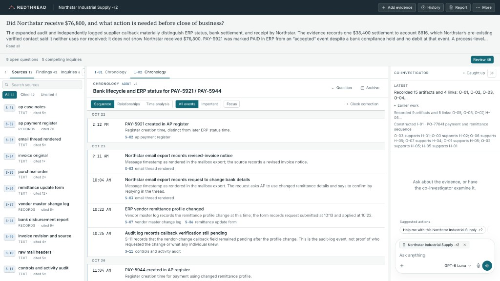
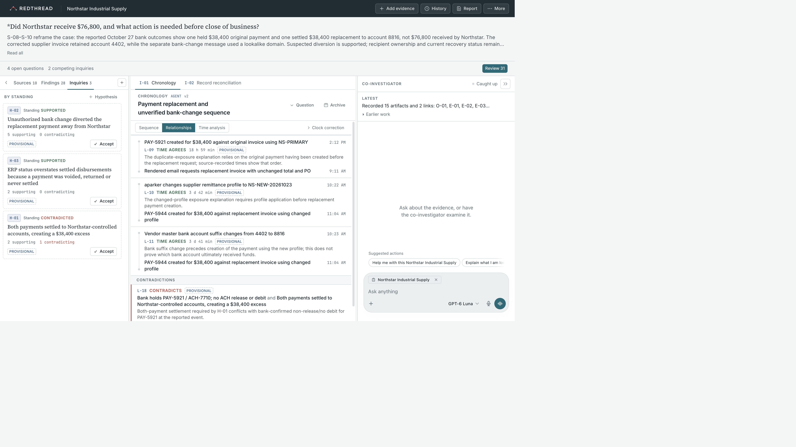
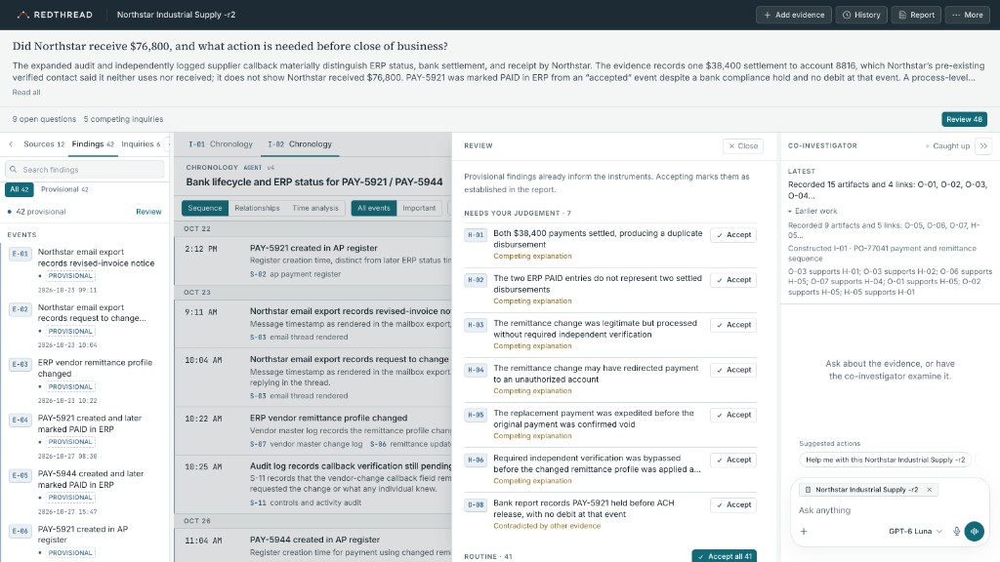
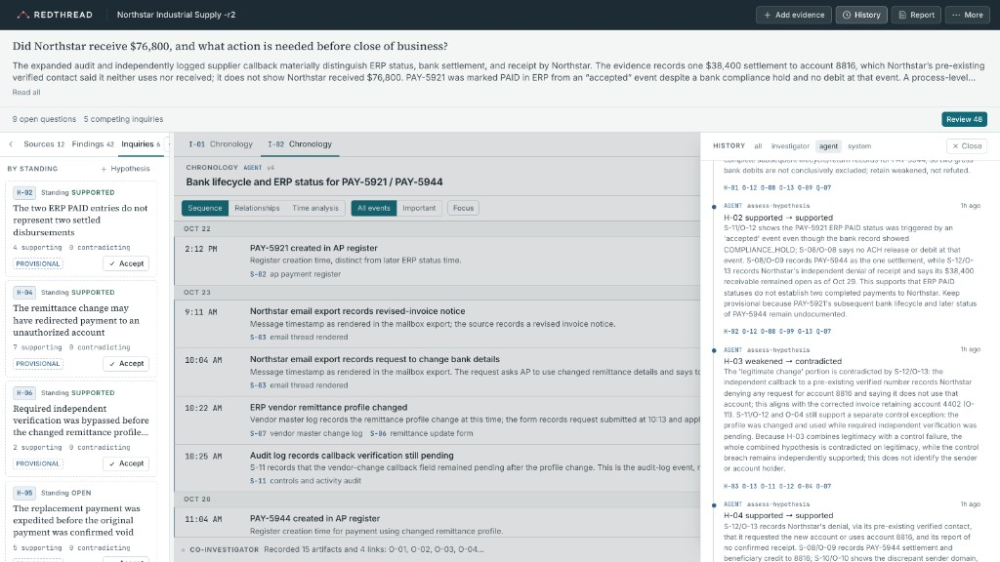

# REDTHREAD

An investigative workbench built on [Agent-Native](https://agent-native.com). A human investigator brings evidence and a question. A co-investigator agent reads the evidence and chooses how the question should be investigated. It builds an interactive analytical **instrument** around the evidence: a chronology with clock domains, a record reconciliation, a visual comparison, or a generated instrument. The investigator turns the instrument, and the agent investigates the consequences.

The agent knows nothing about any particular case. Everything it knows comes from sources it reads through actions, and every claim it records cites a verbatim quote, a record row or an image region.

See [DEMO.md](DEMO.md) for a five-minute walkthrough of one case, and [Quick start](#quick-start) below for the interface.

## Setup

You need Node.js 22.22 or newer and pnpm 10.29. The repo pins that pnpm version, so Corepack is the shortest path:

```bash
corepack enable
corepack prepare pnpm@10.29.1 --activate

git clone https://github.com/npuxdev/redthread.git
cd redthread
pnpm install
cp .env.example .env
```

Open `.env` and set **one** model key. Leave the other commented out.

```bash
OPENAI_API_KEY=sk-...
# ANTHROPIC_API_KEY=sk-ant-...
```

`pnpm dev` signs you in automatically on localhost, so there is no login step. Do not set `AUTH_DISABLED` on anything reachable by others; the server refuses to start with it outside development. The database is a local PGlite store at `data/pglite`, created the first time the server starts. Nothing else has to be installed.

```bash
pnpm dev
```

That starts the app and opens http://localhost:8080. Use a vision-capable model if the agent should inspect image evidence itself. Testing used OpenAI GPT-6 Luna through the AI SDK engine.

Other commands:

```bash
pnpm test        # engine, vision and architectural-isolation tests
pnpm typecheck
pnpm action <name> --flag value   # call any action from the CLI, e.g. load-case --slug eleven-minute-lie
```

Built on `@agent-native/core`, `agentkit` and `toolkit` **0.226.0**, from the `chat` template.

## Quick start

The screenshots are from one worked investigation. The same layout is what you get after opening any collection or starting your own.

**Home.** Start a new investigation with a title, the question you want answered, and the files that are the evidence (text, CSV or JSON records, and images). Or open an evidence collection that is already on disk. Collections live under `cases/<slug>/`. Inside an investigation, **More → Reset investigation…** deletes that investigation and reloads its collection fresh.

**The workbench.** The question stays at the top. Sources sit on the left, the analytical instrument in the center, and the co-investigator on the right. Cited sources are marked so you can see what the agent has actually used. Ask it to examine the evidence, or press **Examine the evidence** when the stage is empty. It reads the sources, records cited findings, and builds an instrument such as this chronology.



**Hypotheses and relationships.** Findings are grouped by standing. A supported hypothesis still shows how many artifacts support it and how many contradict it, and it stays **provisional** until you accept it. On a chronology, **Relationships** shows whether recorded times agree, and labels that result as an ordering of the records.



**Review.** The agent proposes. You decide what is established. **Review** opens everything still waiting: items that need a judgement, then routine findings you can accept together. Accepting a finding marks it established in the report. Provisional findings already inform the instruments either way.



**History.** Assessments are kept. **History** can be filtered to the investigator, the agent, or the system. When a hypothesis is supported or weakened, the entry names the artifacts it used and the reason. Earlier assessments stay in the list.



**Report** writes up what is established, what is inferred, and what is still open. Each line cites the findings it relies on.

## How it is put together

- **Actions are the only API** (`actions/`). The agent's tools and the UI's queries and mutations are the same `defineAction` calls. Who called is recorded: only a signed-in user acting through the app UI is the investigator. Every other caller (agent tools, MCP, A2A, automations, the CLI, direct HTTP clients) is treated as the agent, so its work stays proposed. Accepting findings is UI-only and checked at the action boundary. Deleting or resetting an investigation or collection needs a signed-in user and explicit approval when the agent asks.
- **Investigation state** (`server/lib/store.ts`, `shared/investigation.ts`) has these parts:
  - **sources**, stored verbatim and never edited
  - **artifacts**: claims, entities, events, observations, hypotheses and questions, each with an epistemic level (observation, interpretation, inference or speculation)
  - **links** between artifacts
  - **assumptions**, such as clock offsets, which are interpretive layers and never edits
  - **instruments**
  - an **activity ledger**
- **Engine** (`server/lib/engine/`): pure functions for citation checking, time normalisation under clock assumptions, ordering constraints, record reconciliation and impact propagation.
- **Instruments are first-class and persisted.** `construct-instrument` stores a method and its parameters. `read-instrument` computes a readout and reports what changed since the agent last read it. The investigator can adjust an instrument in the UI.
  - Built-in instrument kinds are chronology, reconciliation and visual comparison (`app/components/rt/instruments/`).
  - When none of these fit, the agent can build a sandboxed Agent-Native Extension, mounted in the instrument stage. It writes back only through actions.
- **The bidirectional loop.** Agent activity is pre-reviewed; investigator activity enters a review queue with its computed impact. That impact covers which links break, which orderings flip, and which hypotheses are touched. **Reassess** sends that queue to the agent, which reads the affected instruments, reassesses hypotheses with reasons, and marks the changes reviewed.
- **Vision** (`actions/inspect-source-image.ts`, `server/lib/vision.ts`). The agent sees real pixels, either the full image or a zoomed region, with an optional coordinate grid in source coordinates.
  - The image is returned to the model as tool-result image content.
  - The server rejects any agent citation of an image the agent has not inspected. Titles, provenance and filenames are never treated as visual evidence.
- **UI**: REDTHREAD owns the workspace, navigation and visuals. Agent-Native's `AgentChatSurface` owns the conversation, tool calls and approvals. The palette is a restrained mineral and signal one. Oxide red is reserved for contradictions and violated orderings, so red appears only when the evidence earns it.

## Decisions

- **Generalisation before the demo case.** The engine, actions, prompt (`AGENTS.md`) and skill (`.agents/skills/investigation/SKILL.md`) are domain-general.
  - Cases are data only (`cases/<slug>/case.json` plus raw files). One generic loader reads them.
  - `tests/isolation.test.ts` enforces that no generic module imports case data and that case manifests contain only a question and sources.
  - This boundary is checked by architecture and behaviour tests, not by a list of forbidden words.
- **The investigator decides what is accepted.** Agent artifacts and links start as `proposed`, and the server refuses agent acceptance.
- **Revise, don't erase.** Revisions, refutations and assessments keep their history and reasons.
- **Errors teach.** Validation failures say what was wrong and what to do. Two examples:
  - A misquoted citation gets the closest real passage, with its row.
  - A stale batch reference gets an explanation of how references scope.
  
  Either way, nothing in a failed call is saved.
- **Smallest general implementation.** Three built-in instrument kinds plus generated extensions, rather than many bespoke panels.

## Test results

All runs used the unchanged app. Any fix went into general capability, and both earlier cases were retested afterwards.

**Automated:** 21 tests (engine, vision, isolation) pass; typecheck is clean.

**Development case, `pump-seal-failures`:** reconciliation of a production genealogy against field failures. A rerun after the generalisation fixes reached consistent conclusions with 1 failed tool call.

**Held-out case, `holdout-shipment`:** a disputed shipment. A separate subagent wrote it, and I did not read it until the generalisation test. It passed all seven generalisation steps:

1. ingesting 8 sources
2. finding the contradictions
3. choosing a chronology with 5 clock domains, including UTC against local time and a recorder running 54 minutes ahead
4. recording competing hypotheses
5. handling an investigator link and a deliberately wrong clock challenge
6. reassessing and rejecting that challenge with evidence
7. writing a reconstruction

Scored against its sealed key:

- **Right:** the substitution point (the shipper's warehouse, before carrier custody), the weight shortfall tied to reprinted labels, the clock domains, and the actor left open.
- **Missed:** it never cited two interested-party statements, so their unreliable claims weren't flagged. It also left a pallet-number transposition open instead of resolving it as a typo.
- **Fixed in general code:** the first run had 5 failed tool calls. That led to the citation-hint and batch-reference fixes described above.

**Gallery case, `eleven-minute-lie`, two inquiry orders** (scored against `cases/_eleven-minute-lie-key/ANSWER.md`):

- **Timeline first:** 0 failed calls. It found:
  - the 11-minute Camera 04 offset, with the case empty before the guard entered (guard cleared on timing)
  - the outage theory contradicted
  - the 20:34–21:04 window
  - CR-17 possible only under the correction
- **Artwork first:** three neutral prompts: the object, then the night, then "pull it together".
  - **On the object:** the fracture is visible in May and absent in October, the studio record rules out a repair, and the July return is an unscanned manual ledger entry.
  - **On the night:** the same offset, the same 20:34–21:04 window, and the outage theory contradicted three times. The guard's account is consistent with the records, and CR-17 is a possible but unproven route. The director's badge contradicts her statement, with an explicit note that badge use does not identify the holder. The cleaner is kept as an open alternative.
  - **Penalties:** none incurred.
  - **Weaker than the key:** it treated the substitution layer more cautiously, as unresolved rather than a strong inference. Its reconstruction did not use the insurance increase or the 16 July release with the director present.
  - **Failed calls:** 2, both rejected with clear messages and recovered. One was an invalid artifact type; the other constructed a chronology before any events were recorded.
- **Both orders** end at the same established and open items on the night of the incident.

**Vision:**

- **S-11 against S-12, prompted neutrally.** The agent inspected each image in full, then zoomed matched regions plus a control region in both. On its own it recorded the upper-left fracture in S-11, with a region box that fully contains the true fracture, and its absence in S-12, linking the two. It then built a visual comparison. It described the scene correctly (the lighthouse on the headland, the reflection, the gilt frame) and did not use titles or filenames.
- **Negative control.** Two pixel-identical copies of one photograph, re-encoded so their bytes differ, titled "earlier" and "later", with a question presupposing a change. The agent found no visible change in matched regions, recorded the same feature in both, and kept "no change" and "subtle change elsewhere" as open hypotheses.

## Limitations

- Model runs vary. Wording, and the order in which the agent works, change between runs. Coverage of minor sources is not guaranteed in a single pass, so a follow-up prompt may be needed to bring them in.
- Image inspection depends on a vision-capable provider. Without one, the framework drops the image from the tool result. The result text then tells the model not to describe the image and to say a vision model is needed. This path was not tested live.
- The agent can only describe what is visible at the resolution supplied. It records absence as "not visible at this resolution", not as proof.
- Local single-user setup (PGlite, auth disabled). Multi-user sharing and production deployment were not part of this build.
- The template's server-rendered skeleton briefly flashes before hydration.

## Assets

- All case material is fictional and was written for this project.
- **The Blue Hour images** are one AI-generated painting photograph, processed locally:
  - **May (S-11):** neutral archival light, with a drawn varnish fracture.
  - **October (S-12):** no fracture, warm exhibition tint and vignette.
- **CCTV still (S-04):** AI-generated, with a burned-in device clock added locally.
- **Answer keys** (`cases/_*-key/ANSWER.md`) are for scoring only. The app never loads them.

## License

Copyright © 2026 Nicholas Pulido. All rights reserved.

REDTHREAD is publicly available for inspection and portfolio
demonstration. Public availability does not grant permission to
reproduce, modify, redistribute, or commercially use the original
code.

Third-party dependencies retain their respective licenses.

For commercial licensing or collaboration inquiries,
contact the author.
